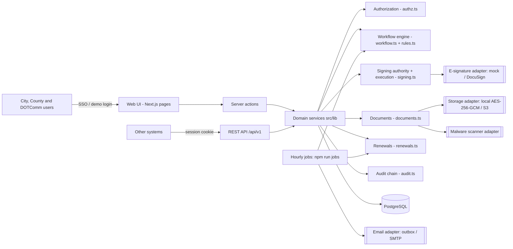
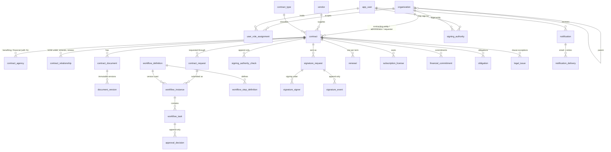

# Architecture

One modular Next.js application (TypeScript) on PostgreSQL. Every outside system sits behind an
interface with a labeled development implementation.

## Layers

| Layer | Responsibility | Rule |
| --- | --- | --- |
| Pages (`src/app/(app)`) | Render data, collect input | Never decide permissions; hide controls only as a convenience. |
| Server actions / API routes | Authenticate, call one service function, map errors | Read-only accounts are refused here for every mutation. |
| Services (`src/lib`) | All business rules and authorization | Every function takes an `Actor` and checks scope and role itself. Out-of-scope records raise "not found". |
| Database | Integrity of record | Append-only triggers, revoke-only signing authority, unique constraints, foreign keys. |

## Key design decisions

- **Ownership never implies signing authority.** Signatories come only from `signing_authority`
  (entity, limit, contract types, dates, authorizing reference). Delegations are valid only while the
  delegating official's own authority covers the contract. Checks are written to
  `signing_authority_check` whether they pass or fail.
- **Approvals are pinned.** Each `approval_decision` records the agreement's SHA-256, the workflow
  definition version and a hash of the routing context. Signing is blocked if the agreement or terms
  differ from what was approved (see `executionBlockers` in `signing.ts`).
- **Workflows are data.** Definitions are versioned; editing publishes a new version and running
  requests keep theirs. Routing rules use a safe JSON-logic subset (`rules.ts`) — no code execution.
- **Calendar dates are strings.** Effective, expiration and notice dates are `date` columns handled as
  `YYYY-MM-DD`; "today" is computed in the contracting entity's time zone.
- **Commitments are not spending.** `financial_commitment` records contractual obligations; purchase
  orders and invoices are references to the ERP, the system of record.
- **The mock is never a legal execution.** Mock completions produce `DEMO_EXECUTED`, banners on the
  contract, "DEMO" documents, no auto-renewal, and exclusion from financial reports.

## Contract lifecycle

```mermaid
stateDiagram-v2
  [*] --> DRAFT
  DRAFT --> IN_REVIEW: submit (rules route the approvals)
  IN_REVIEW --> IN_LEGAL: Legal stage starts
  IN_LEGAL --> IN_REVIEW: Legal clears; later stages
  IN_REVIEW --> DRAFT: returned for changes
  IN_LEGAL --> DRAFT: Legal requests changes
  IN_REVIEW --> CANCELLED: rejected / withdrawn
  IN_REVIEW --> PENDING_SIGNATURE: all approvals complete
  PENDING_SIGNATURE --> IN_REVIEW: material change re-opens approvals
  PENDING_SIGNATURE --> ACTIVE: executed (authority re-checked)
  ACTIVE --> ACTIVE: auto-renewal rolls the term
  ACTIVE --> EXPIRED: term ends
```

## Data model (core entities)

Other tables: `role`, `approval_delegation`, `vendor_contact`, `contract_amendment`,
`purchase_order_ref`, `action_item`, `clause_template`, `notification_preference`, `audit_log`,
`app_setting`, `counter`, `job_run`. Full definitions: `src/db/schema.ts`; migrations in `drizzle/`.

## Module inventory against the charter

| Charter module | Phase 1 |
| --- | --- |
| A Executive dashboard | Built (role-scoped) |
| B Repository | Built; saved views and bulk import are backlog |
| C Contract types | Built (14 categories, custom fields per category) |
| D Intake | Built (8 request types) |
| E Workflow engine | Built |
| F Legal review | Built (versioned .docx workflow; no in-browser redlining by design) |
| G E-signature | Adapter + mock + external execution; production provider pending Decision 7 |
| H Renewals | Built |
| I SaaS | Read views and utilization; editing is backlog |
| J Financials | Commitments and allocations; ERP feed pending the ERP selection |
| K Vendors | Directory and profiles; performance scoring is backlog |
| L Obligations | Read view; editing and escalation are backlog |
| M Reports | Nine CSV reports |
